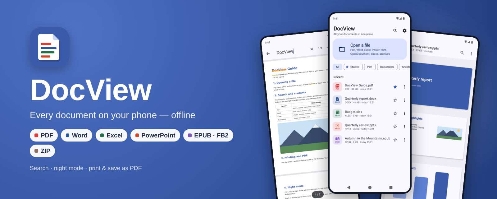
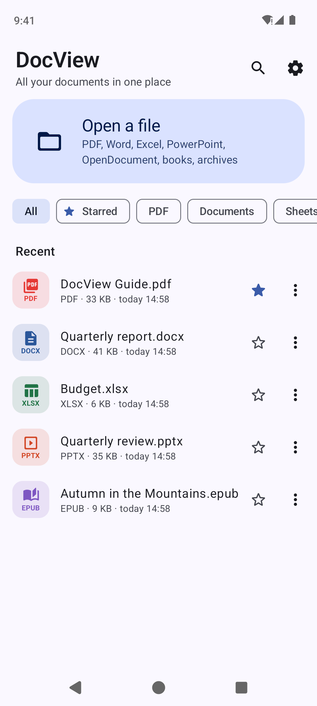
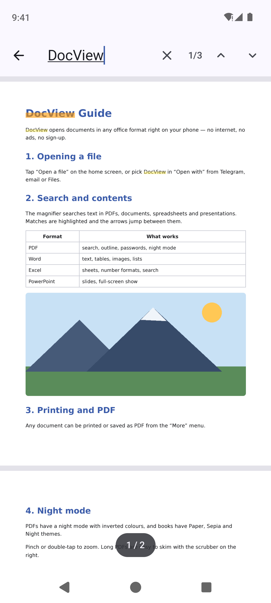
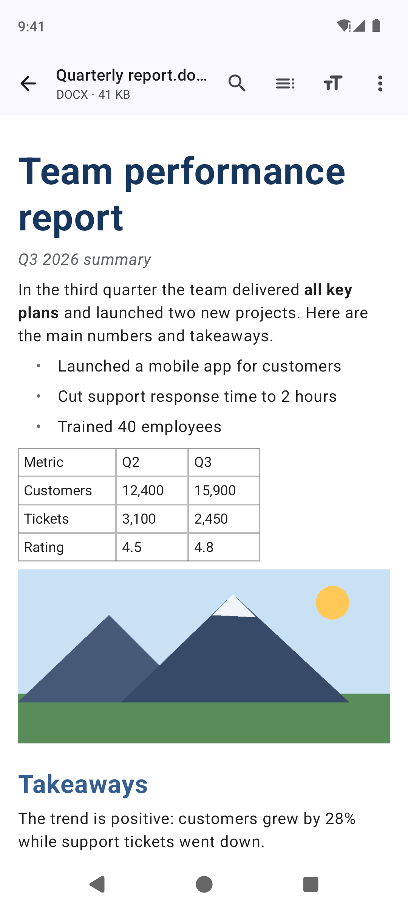
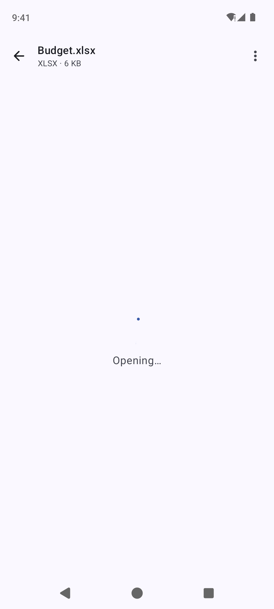
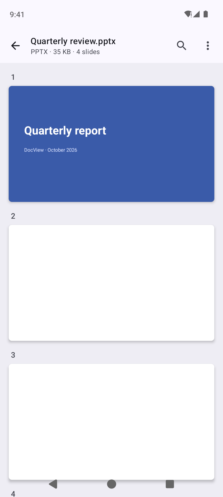
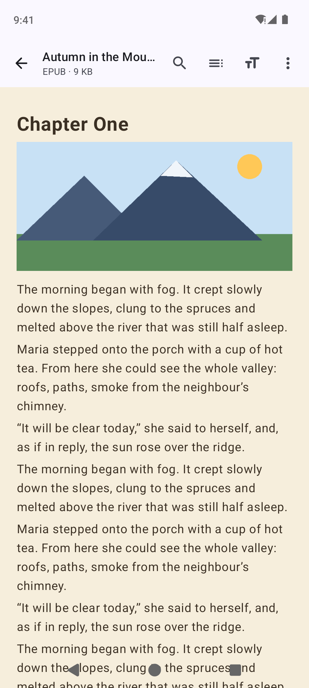
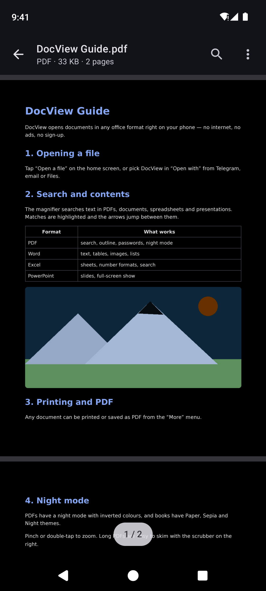
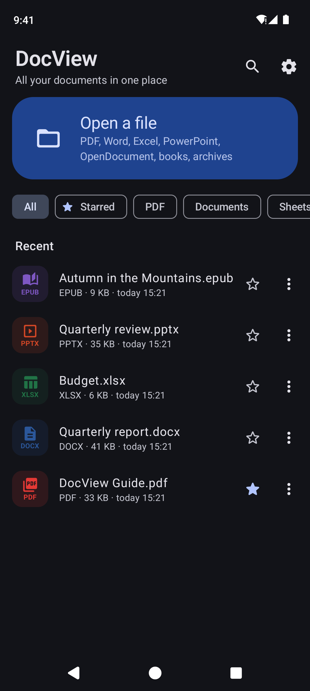

<p align="center">
  
</p>

<p align="center">
  <a href="https://github.com/hatogg/DocView/releases/latest"></a>
  <a href="https://github.com/hatogg/DocView/actions/workflows/build.yml"></a>
  
  
  <a href="LICENSE"></a>
</p>

<p align="center"><a href="README.md">Українська</a> &nbsp;|&nbsp; <b>English</b></p>

**DocView** is a document viewer for Android that opens everything that usually lands in your messenger or inbox: PDF, Word, Excel, PowerPoint, OpenDocument, e-books and archives. One app instead of five — no ads, no sign-up, no internet. Your files never leave the phone.

<p align="center">
  <a href="https://github.com/hatogg/DocView/releases/latest"></a>
</p>

<p align="center">
  
  
  
  
</p>
<p align="center">
  
  
  
  
</p>

<sub>Real screenshots: GitHub Actions runs the app in an Android 14 emulator and opens demo documents.</sub>

## What it opens

| | Formats | What it does |
| --- | --- | --- |
| 📕 **PDF** | `.pdf` | Smooth scrolling and zoom up to 600% with sharp text, text search with highlights, outline (bookmarks), password-protected PDFs, night mode, go to page, a scrubber for long files |
| 📘 **Word** | `.docx` `.doc` `.odt` `.rtf` | Headings, bold/italic/colour, numbered lists, tables, images, contents from headings. Old Word 97–2003 `.doc` and even Word 95 |
| 📗 **Excel** | `.xlsx` `.xls` `.ods` `.csv` | Sheets, number and date formats, merged cells, colours, frozen row and column headers, search, pinch zoom |
| 📙 **PowerPoint** | `.pptx` `.ppt` `.odp` | Slides with shapes, pictures, tables and backgrounds, speaker notes, full-screen show with swiping |
| 📚 **Books** | `.epub` `.fb2` `.fb2.zip` | Contents, Paper / Sepia / Night themes, text size, remembers where you stopped |
| 📄 **Text** | `.txt` `.md` `.html` `.json` `.xml`, code | Any encoding (UTF-8, Windows-1251), Markdown with formatting |
| 🗜️ **Other** | `.zip`, images | Browse an archive and open files from it, zoomable images |

Plus for every document: **print**, **save as PDF**, Share, Open in another app, properties (pages, words, author), history with starred files and reading progress, Material You and a dark theme.

## Install

1. On your phone, open the [latest release](https://github.com/hatogg/DocView/releases/latest) and download `DocView-<version>.apk`.
2. Open the downloaded file and allow installs from that source.
3. **Install** → **Open**.

Requires Android 8.0 or newer. New versions install over the old one.

**Opening files from Telegram, WhatsApp or email:** tap the file → “Open with” → **DocView** (you can choose “Always”). Or use “Open a file” inside DocView.

## Privacy

The app **has no internet permission** (the build checks this automatically), so documents never leave the phone. DocView doesn't ask for access to all your storage: files only arrive through the system file picker or “Open with”, and the copies kept for history live in the app's own storage.

## For developers

Kotlin, Jetpack Compose, Material 3. PDFs are drawn by the system `PdfRenderer`; search and passwords use [PdfBox-Android](https://github.com/TomRoush/PdfBox-Android). All office formats are parsed by an in-house core with no third-party libraries:

```
app/src/main/java/ua/x44to/docview/
├── core/               ← plain Kotlin, no Android: testable on a regular JVM
│   ├── Xml.kt          ← streaming XML/HTML parser
│   ├── Cfb.kt          ← OLE2 container of old DOC/XLS/PPT
│   ├── Docx.kt Xlsx.kt Pptx.kt Odf.kt   ← Office 2007+ and OpenDocument
│   ├── Doc97.kt Xls.kt Ppt97.kt         ← Office 97–2003 (piece table, BIFF8, persist directory)
│   ├── Rtf.kt Html.kt Books.kt Text.kt  ← RTF, HTML, EPUB, FB2, TXT/CSV/Markdown, ZIP
│   └── NumFmt.kt       ← Excel number and date formats
├── pdf/                ← PdfRenderer with zoom and sharp tiles, search via PdfBox
├── render/             ← slide drawing on Canvas (screen and PDF)
├── export/             ← any document → PDF, printing
└── ui/                 ← home screen and a viewer for each type
```

- **Build:** Android Studio or `./gradlew assembleRelease` (JDK 17, Android SDK 35).
- **GitHub Actions** ([build.yml](.github/workflows/build.yml)) builds the APK, checks it has no internet permission and publishes it to the `v<versionName>` release.
- **Screenshots** ([screenshots.yml](.github/workflows/screenshots.yml)) come from an Android 14 emulator: a test opens demo documents in Ukrainian and English, light and dark.
- **Signing:** the `signing/docview.jks` key is in the repo so every build installs over the previous one. For Google Play, replace it with your own and pass the passwords as `DV_STORE_PASS` / `DV_KEY_PASS` secrets.

## License

[MIT](LICENSE) © x44to. PdfBox-Android is under the Apache License 2.0.
