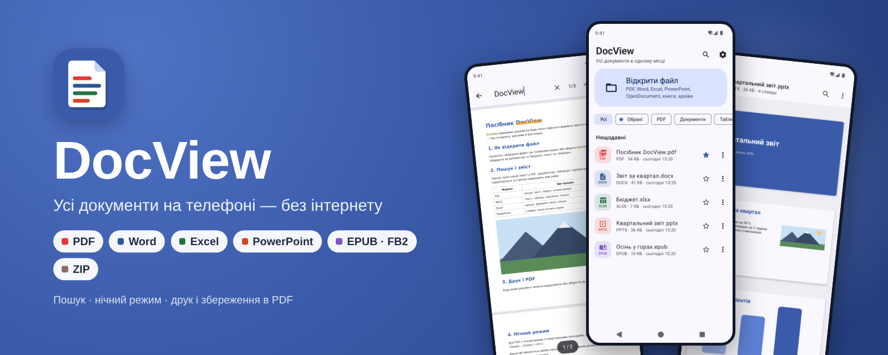
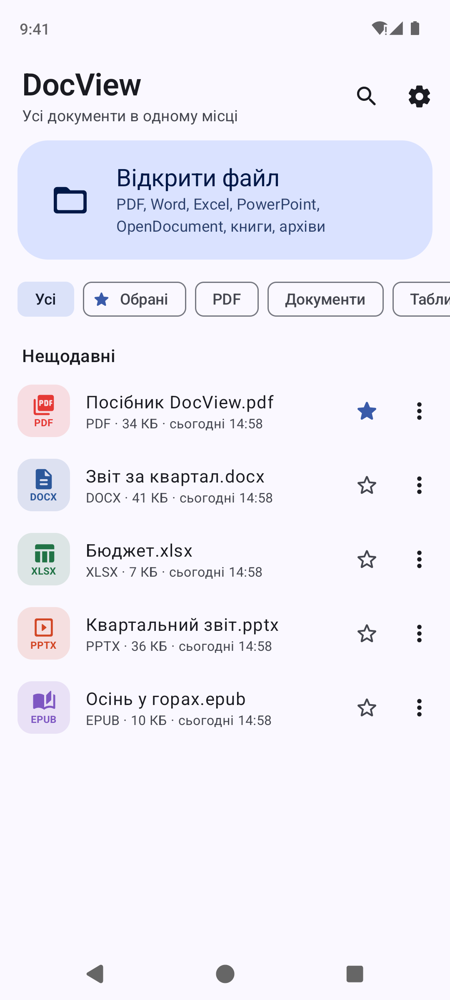
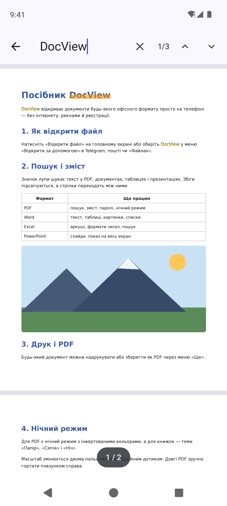
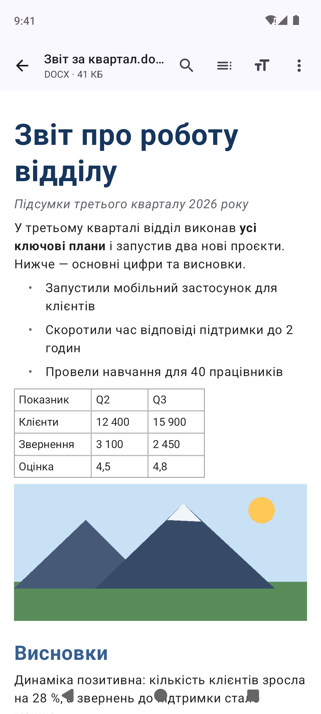
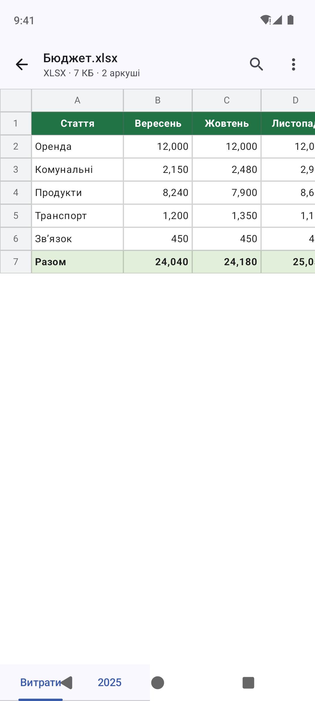
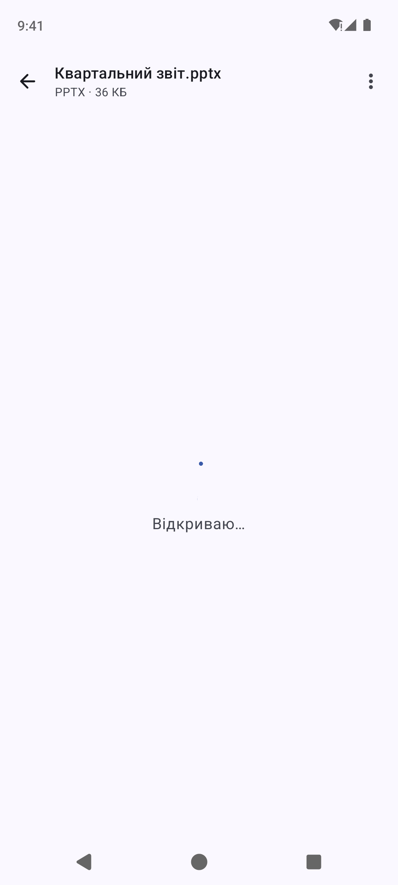
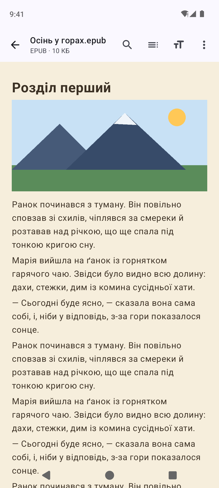
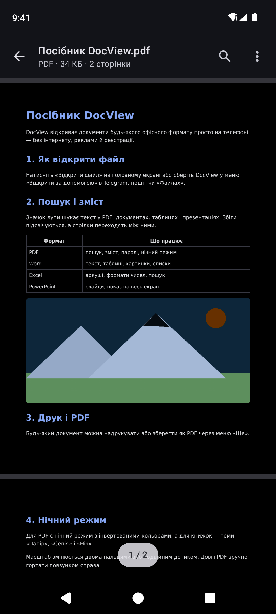
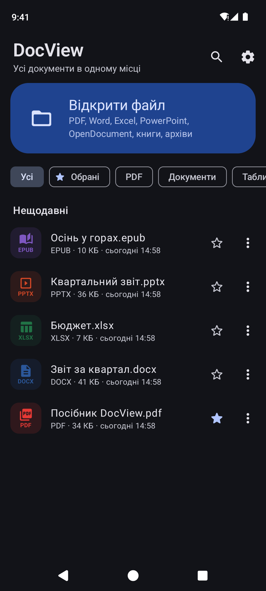

<p align="center">
  
</p>

<p align="center">
  <a href="https://github.com/hatogg/DocView/releases/latest"></a>
  <a href="https://github.com/hatogg/DocView/actions/workflows/build.yml"></a>
  
  
  <a href="LICENSE"></a>
</p>

<p align="center"><b>Українська</b> &nbsp;|&nbsp; <a href="README.en.md">English</a></p>

**DocView** — переглядач документів для Android, який відкриває все, що зазвичай приходить у месенджері чи пошті: PDF, Word, Excel, PowerPoint, OpenDocument, електронні книги й архіви. Один застосунок замість п'яти, без реклами, реєстрації та інтернету — файли нікуди не надсилаються.

<p align="center">
  <a href="https://github.com/hatogg/DocView/releases/latest"></a>
</p>

<p align="center">
  
  
  
  
</p>
<p align="center">
  
  
  
  
</p>

<sub>Справжні скриншоти: GitHub Actions запускає застосунок в емуляторі Android 14 і відкриває демо-документи.</sub>

## Що відкриває

| | Формати | Що вміє |
| --- | --- | --- |
| 📕 **PDF** | `.pdf` | Плавне гортання й масштаб до 600 % з чіткими літерами, пошук тексту з підсвіткою, зміст (закладки), PDF з паролем, нічний режим, перехід на сторінку, повзунок для довгих файлів |
| 📘 **Word** | `.docx` `.doc` `.odt` `.rtf` | Заголовки, жирний/курсив/колір, списки з нумерацією, таблиці, картинки, зміст за заголовками. Старі `.doc` з Word 97–2003 і навіть Word 95 |
| 📗 **Excel** | `.xlsx` `.xls` `.ods` `.csv` | Аркуші, формати чисел і дат, об'єднані комірки, кольори, закріплені заголовки рядків і стовпців, пошук, масштаб двома пальцями |
| 📙 **PowerPoint** | `.pptx` `.ppt` `.odp` | Слайди з фігурами, картинками, таблицями й фоном, нотатки доповідача, показ на весь екран з гортанням |
| 📚 **Книги** | `.epub` `.fb2` `.fb2.zip` | Зміст, теми «Папір», «Сепія», «Ніч», розмір тексту, запам'ятовує, де ви зупинились |
| 📄 **Текст** | `.txt` `.md` `.html` `.json` `.xml` код | Кирилиця в будь-якому кодуванні (UTF-8, Windows-1251), Markdown з форматуванням |
| 🗜️ **Інше** | `.zip`, картинки | Перегляд архіву й відкриття файлів з нього, картинки з масштабом |

Плюс для будь-якого документа: **друк**, **збереження в PDF**, «Поділитися», «Відкрити в іншому застосунку», властивості (сторінки, слова, автор), історія з обраними файлами й прогресом читання, Material You і темна тема.

## Встановлення

1. На телефоні відкрийте [останній реліз](https://github.com/hatogg/DocView/releases/latest) і завантажте `DocView-<версія>.apk`.
2. Відкрийте завантажений файл і дозвольте встановлення з цього джерела.
3. **Встановити** → **Відкрити**.

Потрібен Android 8.0 або новіший. Нові версії ставляться поверх старої.

**Як відкривати файли з Telegram, Viber чи пошти:** натисніть на файл → «Відкрити за допомогою» → **DocView** (можна зробити «Завжди»). Або в самому DocView — «Відкрити файл».

## Приватність

У застосунку **немає дозволу на інтернет** (збірка перевіряє це автоматично) — документи ніколи не залишають телефон. DocView не просить доступу до всієї пам'яті: файли надходять лише через системний вибір файлів або «Відкрити за допомогою», а їхні копії для історії лежать у пам'яті самого застосунку.

## Для розробників

Kotlin, Jetpack Compose, Material 3. PDF малює системний `PdfRenderer`, пошук і паролі — [PdfBox-Android](https://github.com/TomRoush/PdfBox-Android). Усі офісні формати розбирає власне ядро без сторонніх бібліотек:

```
app/src/main/java/ua/x44to/docview/
├── core/               ← чистий Kotlin, без Android: можна перевіряти на звичайній JVM
│   ├── Xml.kt          ← потоковий XML/HTML-розбирач
│   ├── Cfb.kt          ← контейнер OLE2 старих DOC/XLS/PPT
│   ├── Docx.kt Xlsx.kt Pptx.kt Odf.kt   ← Office 2007+ і OpenDocument
│   ├── Doc97.kt Xls.kt Ppt97.kt         ← Office 97–2003 (piece table, BIFF8, persist directory)
│   ├── Rtf.kt Html.kt Books.kt Text.kt  ← RTF, HTML, EPUB, FB2, TXT/CSV/Markdown, ZIP
│   └── NumFmt.kt       ← числові формати й дати Excel
├── pdf/                ← PdfRenderer з масштабом і чіткими фрагментами, пошук через PdfBox
├── render/             ← малювання слайдів на Canvas (екран і PDF)
├── export/             ← будь-який документ → PDF, друк
└── ui/                 ← головний екран і переглядачі для кожного типу
```

- **Збірка:** Android Studio або `./gradlew assembleRelease` (JDK 17, Android SDK 35).
- **GitHub Actions** ([build.yml](.github/workflows/build.yml)) збирає APK, перевіряє, що в ньому немає дозволу на інтернет, і викладає його в реліз `v<versionName>`.
- **Скриншоти** ([screenshots.yml](.github/workflows/screenshots.yml)) знімає емулятор Android 14: тест відкриває демо-документи українською й англійською, у світлій і темній темі.
- **Підпис:** ключ `signing/docview.jks` лежить у репозиторії, щоб кожна збірка ставилася поверх попередньої. Для Google Play замініть його своїм і передайте паролі секретами `DV_STORE_PASS` / `DV_KEY_PASS`.

## Ліцензія

[MIT](LICENSE) © x44to. PdfBox-Android — Apache License 2.0.
